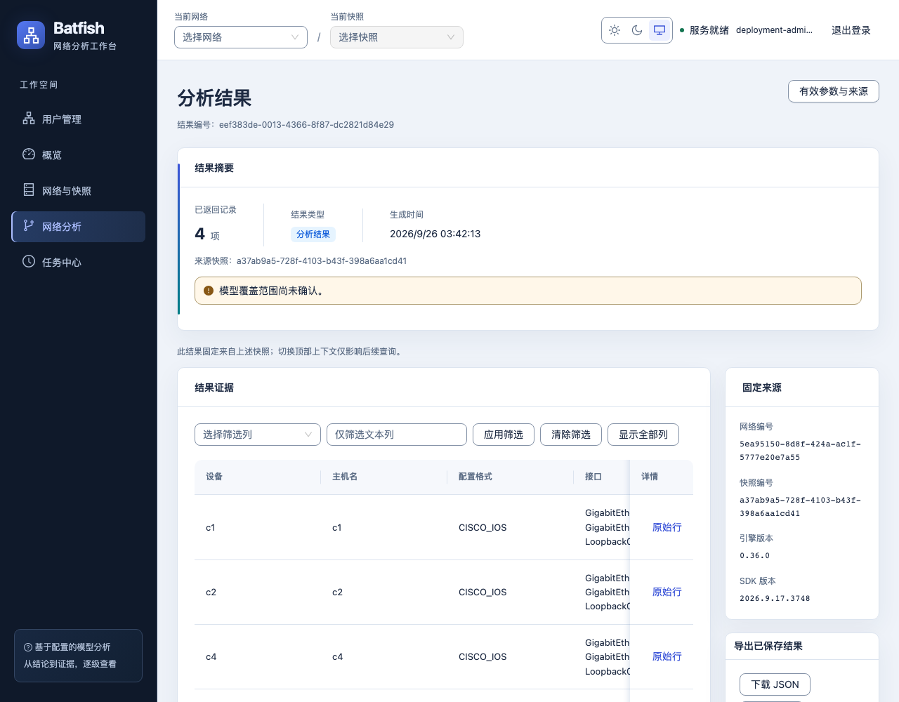
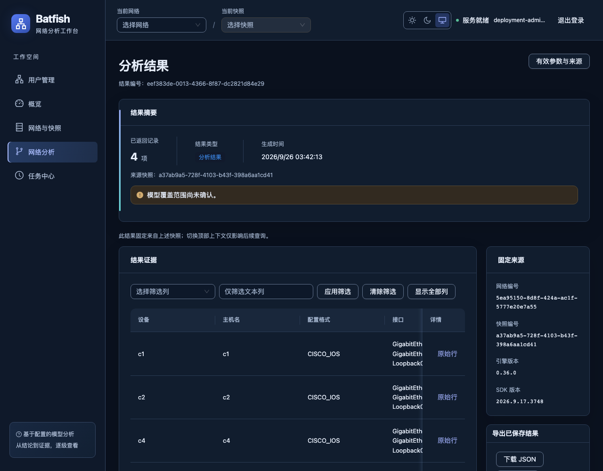

# 技术工作台双主题验收记录

日期：2026-09-26。状态：功能交付，必需自动检查通过。下述为双主题交付时的历史验证；后续MVP复验已修复焦点环小项，见文末补充。范围仅为现有 `web/frontend`；无后端、Java、数据库或 ADV/领导端功能修改。未提交、推送或合并。

## 交付内容

- 浅色、深色、跟随系统；默认跟随系统，浏览器保存偏好，异常或损坏存储安全回退。登录、强制改密和工作台均提供入口。
- 首屏独立脚本、Ant Design 主题与语义 CSS 变量；正文、卡片、表格、配置内容、下拉、弹窗、详情抽屉统一适配。
- 深蓝导航、查询导航层次、摘要/证据/固定来源/导出布局；路径表格允许横向滚动，避免窄列逐字换行。
- 切换不重建 QueryClient、不清除表单或上下文、不自动提交查询。摘要只使用保存 DTO；模型警告和截断仍在第一层。
- 未增加依赖。已更新[前端规范](../frontend.md)、[设计](../plans/2026-09-26-technical-workbench-design.md)及[实施计划](../plans/2026-09-26-technical-workbench-implementation.md)。

## 验证

命令工作目录：前端命令在 `web/frontend`，lab 命令在仓库根目录。使用仓库锁定的 pnpm 11.19.0。

| 验证 | 本轮结果 |
| --- | --- |
| `pnpm test` | 16 文件、43 测试通过，包含 6 项主题/状态/对比度测试 |
| `pnpm check:api` | 通过，接口类型未漂移 |
| `pnpm build` | 类型检查及生产构建通过 |
| `pnpm format:check`、`git diff --check` | 通过 |
| `web/backend/.venv/bin/python web/scripts/lab.py smoke` | 12 通过、277 未选择；证据 run `ff4fad5999d9` |
| `BFW_TEST_THEME=light pnpm exec playwright test` | 14 通过 |
| `BFW_TEST_THEME=dark pnpm exec playwright test` | 14 通过 |
| 审查修复后 `playwright test tests/theme.spec.ts tests/traceroute.spec.ts` | 6 通过，覆盖两套配置及路径表格调整 |
| HTTPS 生产 `playwright.deployment.config.ts`，两主题各执行 | 各 3 通过：实际控件对比度、持久化/浮层/保存结果、阻断应用 bundle 后首屏背景 |
| HTTPS 生产 `playwright.acceptance.config.ts`，两主题各执行 | 各 1 通过：管理员与成员独立上下文、两套配置、交错查询、刷新、权限和会话撤销 |

生产命令设置 `BFW_DEPLOYMENT_STATE=web/.runtime/deploy-mvp25-release-restored` 的绝对路径和 `BFW_DEPLOYMENT_EVIDENCE=web/.runtime/deploy-mvp25-release/verification.json` 的绝对路径；后者只提供旧环境身份与已有结果，实际页面与双用户测试均为本轮重新运行。新增控件检查在两种运行设置下主动切到深色测试最不利状态。

真实流程覆盖：登录/用户管理、上传初始化、任务取消与重试、设备/接口/路由/LPM、诊断、虚拟路径、JSON/CSV 导出、删除确认与固定结果来源。桌面1280/1920验证导航、长名称、键盘和无页面溢出；主题测试另检查1440/768/390布局。使用 r1/r2 与 Cisco 四设备合成配置，无真实路由器，不验证核心仿真与现场转发一致性。

原始日志及浏览器附件位于 `web/.runtime/theme-upgrade/`、`web/.runtime/theme-*.log`；这些目录为本机证据，未加入版本控制。测试凭据未写入文档。

## 版本身份

- 基准 HEAD：`80652f6922517c3d5cf0720c3a403aa693321f9c`；当前分支 `codex/mvp-integration-lab`，本轮为未提交增量。
- 前端源码指纹：`3908833a1f70c797702980803859a4d07ee97b58800e0e94a6a2310e1ff39601`。计算方式：对 Git 跟踪及未忽略的 `web/frontend` 文件按路径排序，拼接路径、NUL、文件字节、NUL 后 SHA-256。
- 本地测试前端镜像 `bfw-frontend:technical-theme-20260926`：`sha256:960b3769ac90befc48e675ea7a3d9de9a93f01a86c6d7f359bef7e7c6006c80d`。
- host lab `abb77b60f0c0`：API 18000、引擎19996、PostgreSQL15439、迁移0008。
- HTTPS隔离环境：`bfw-1c23e5e71e49`，`https://localhost:18444`；仅替换 proxy 镜像，后端/worker/引擎/数据库保持原版本。
- 引擎 revision `7d0deeeac4a09973b3876327f6aef721ee12f955`；JAR SHA-256 `0927de7c740bc72f999870e842605baad9a7cb6ea66e4b01fb9a6037bea00193`；SDK `2026.9.17.3748`。

## 独立审查与修复

完成一次独立只读审查。无接口、权限、QueryClient身份或结果来源回归。审查后在生产浏览器先重现再修复：普通按钮悬停文字对比2.60、按下1.89，复选框勾选1.77；新增 `dark controls preserve readable hover, active and checked states` 在修复前失败、修复后通过。显式区分普通按钮文字和实心按钮底色，Checkbox/Radio使用实色主色。全量43项单测、构建及受影响浏览器测试再次通过。

首轮失败没有隐藏：删除测试两项依赖第一页网络、首屏测试一项未匹配Vite入口的时间戳查询参数、一项路径测试被作者编辑主题触发HMR中断。修复测试定位并冻结源码后，深浅完整14项分别通过。浅色输入边界从2.25提升到3.16，对应语义对比度测试先失败后通过。

非阻断余项：浅色模式的侧栏键盘焦点环对深蓝背景为2.993:1，略低于3:1目标，独立审查定为Minor并暂缓；键盘操作与焦点可见性检查通过，不能据此宣称整站已通过完整WCAG审计。构建仍有共享Ant Design chunk大于500KB的提示，本轮未扩大到打包优化。

执行决策：沿用已有专用分支并保留改动（后续需安排提交）；本机隔离HTTPS环境仅更新前端（该测试地址现在显示新版本）；修复旧删除测试的分页定位（仅增加测试耗时，不改变业务）。保留原MVP证据和无关 `.pnpm-store/`、`.superpowers/`。

## 已实际查看的生产页面

浅色与深色结果页：

浮层截图：[浅色详情](technical-workbench-theme-2026-09-26/light-https-result-drawer.png)、[深色详情](technical-workbench-theme-2026-09-26/dark-https-result-drawer.png)。

## 后续 MVP 全量复验补充

2026-09-26 用户授权提交前的全量复验中，侧栏焦点环改用独立 `--nav-accent`，解决原2.993:1小项。新增MVP-20/21的429拒绝恢复修复，与主题身份状态无关。最终源码、测试及提交前证据见 [MVP全量复验](mvp-recheck-2026-09-26.md)，本页此前指纹和计数保留为历史，不代表最新源码身份。
